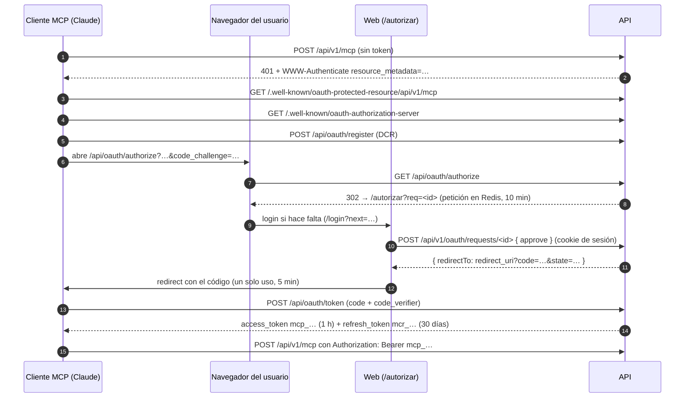

# Servidor MCP: la IA gestiona dispositivos y pantallas

La API trae un servidor [MCP](https://modelcontextprotocol.io) para que un asistente (Claude Code, claude.ai, Claude Desktop, Cursor…) cree dispositivos y pantallas MetaDisplay y actualice sus datos en nombre de un usuario.

El acceso se autoriza con **OAuth 2.1**. El usuario aprueba la conexión en la web con su sesión y la puede revocar cuando quiera.

| | |
|---|---|
| URL del MCP | `https://<tu-dominio>/api/v1/mcp` (prod: `https://atekos.toxolinko.site/api/v1/mcp`; dev: `http://localhost:8080/api/v1/mcp`) |
| Transporte | Streamable HTTP sin estado: un `POST` por mensaje JSON-RPC y respuesta en JSON. No hay stream `GET` ni sesiones. |
| Autorización | OAuth 2.1 con registro dinámico de clientes (DCR), PKCE S256 y refresh tokens con rotación. |
| Código | `apps/api/src/mcp/` (servidor y ruta) y `apps/api/src/modules/oauth/` (servidor de autorización). |

## Arquitectura

La API es a la vez **servidor de autorización** y **servidor de recursos**. El MCP no reenvía tokens ni llama a la REST: llama a los mismos casos de uso (`c.devices.*`, `c.displays.*`). Por eso los permisos, la validación, la caché de Redis, el log de eventos y el envío en vivo a las pantallas son idénticos a los de la web.



### Endpoints

| Ruta | Quién | Qué hace |
|---|---|---|
| `GET /.well-known/oauth-protected-resource/api/v1/mcp` | público | Metadatos del recurso (RFC 9728): `resource` y `authorization_servers`. |
| `GET /.well-known/oauth-authorization-server` | público | Metadatos del servidor de autorización (RFC 8414). |
| `POST /api/oauth/register` | público, 20/h por IP | Registro dinámico de clientes (RFC 7591). |
| `GET /api/oauth/authorize` | navegador, 100/15 min por IP | Valida cliente, `redirect_uri`, PKCE S256 y `resource`, y redirige a `/autorizar`. |
| `POST /api/oauth/token` | cliente, 50/15 min por IP | `authorization_code` y `refresh_token`. Va en `application/x-www-form-urlencoded`. |
| `POST /api/oauth/revoke` | cliente | Revoca el grant de un access o refresh (RFC 7009). |
| `GET` / `POST /api/v1/oauth/requests/:id` | sesión | La pantalla de consentimiento: ver la petición y aprobarla o denegarla. |
| `GET /api/v1/oauth/grants` · `DELETE /api/v1/oauth/grants/:id` | sesión | «Apps conectadas» en la página Tokens: listar y revocar. |
| `POST /api/v1/mcp` | Bearer OAuth, 300/min por app | Mensajes MCP. `GET` y `DELETE` → 405. |

Las rutas de OAuth van bajo `/api/oauth/` y no en la raíz porque `/register` es una ruta de la web. Solo los dos `/.well-known/oauth-*` tienen que estar en la raíz del dominio: Caddy los envía a la API.

## Permisos

El consentimiento concede estos scopes. El cliente puede pedir menos; si no pide ninguno válido, se conceden los tres.

| Scope | Permite |
|---|---|
| `devices:read` | `list_devices`, `get_device`. |
| `devices:write` | `create_device`, `set_device_state`, `update_device_data`. |
| `displays:write` | `list_displays`, `get_display`, `create_display`, `set_display_template`, `update_display_data`. |
| cualquiera | `get_display_contract` y los recursos del contrato (es público). |

- El grant actúa como un **token sin ligar del usuario** (`kind: 'token'`, sin `deviceId` ni `displayId`). Las políticas de siempre (`canRead`, `canWrite`, `canAdminDisplay`) deciden con sus scopes.
- **Altas:** `canCreate` (`apps/api/src/modules/devices/domain/policy.ts`) deja crear a la sesión y a un token sin ligar con el scope de escritura. La REST no cambia: `POST /devices` y `POST /displays` siguen exigiendo sesión en la ruta. Solo el MCP llega al caso de uso con un token.
- **No se exponen** borrar dispositivos o pantallas, crear tokens, cambiar la visibilidad, enviar comandos a la pantalla ni la telemetría.

## Herramientas

Todas devuelven el JSON del caso de uso en `content[0].text`. Un error del dominio vuelve como **resultado con `isError: true`** y el cuerpo `{ error, message, issues }`, con los mismos códigos que la REST (`not_found`, `forbidden`, `conflict`, `invalid_template`…). Un argumento que no cumple el esquema vuelve como `isError` con el detalle de zod. En los dos casos la IA puede corregir y reintentar.

| Herramienta | Entrada | Devuelve |
|---|---|---|
| `list_devices` | — | `Device[]` |
| `get_device` | `{ id }` (uuid) | `Device` |
| `create_device` | `{ slug, name, type?, visibility?, description?, data? }` (`CreateDeviceInput`) | `Device` (409 `conflict` si el slug ya es tuyo) |
| `set_device_state` | `{ id, state }` | `Device` |
| `update_device_data` | `{ id, data }`, con merge superficial sobre `data` | `Device` |
| `list_displays` | — | `Display[]` |
| `get_display` | `{ deviceId }` (`md-` + 12 hex) | `DisplayDetail`: plantilla activa, plantillas y valores |
| `create_display` | `{ deviceId, name }` | `Display`, con la plantilla `inicio` |
| `set_display_template` | `{ deviceId, template }` (`DisplayTemplate`) | `DisplayDetail`. Guarda y activa la plantilla; si la pantalla está online, la recibe al momento. |
| `update_display_data` | `{ deviceId, values }` (`DisplayValues`), con merge | `{ values }` |
| `get_display_contract` | `{ part?: 'asyncapi' \| 'openapi' }` (por defecto `asyncapi`) | El contrato MetaDisplay vigente: `info.version` e `info["x-updated"]` dicen su versión y su última actualización ([`metadisplay/README.md`](metadisplay/README.md)). |

Los esquemas de entrada son los de `packages/shared`, así que la IA recibe el mismo JSON Schema que valida la REST. El servidor manda además unas `instructions` breves: el lienzo de 172×320, el flujo de las pantallas, qué no puede hacer y que consulte el contrato antes de diseñar.

El contrato también está como **recursos MCP**, `atekos://contract/asyncapi.json` y `atekos://contract/openapi.json`, para los clientes que permiten adjuntarlos (por ejemplo, con `@` en Claude Code).

### Flujo típico de una pantalla

1. `create_display { "deviceId": "md-34B7DA01ABCD", "name": "Salón" }`.
2. `set_display_template` con una plantilla como [`status-template.json`](metadisplay/examples/status-template.json). Es un lienzo de 172×320; los elementos `text`, `progress` y `button` llevan `value` fijo o `bind` a una variable. Para cambiar una plantilla que ya existe con el mismo `id`, sube `version`.
3. `update_display_data { "deviceId": "md-34B7DA01ABCD", "values": { "serverStatus": "OK", "daysText": "hace 2 min" } }`.
4. La pantalla física necesita su token `display:connect`, que el usuario crea en la web (Tokens). El MCP no crea tokens.

Formato completo de plantillas y valores: [`metadisplay/DISENO.md`](metadisplay/DISENO.md) y [`metadisplay/CONTRATO.md`](metadisplay/CONTRATO.md).

## Conectar un cliente

Todos descubren OAuth solos a partir de la URL: no hay que copiar tokens.

**Claude Code**

```bash
claude mcp add --transport http --scope user atekos https://atekos.toxolinko.site/api/v1/mcp
```

Después, dentro de Claude Code: `/mcp` → `atekos` → *Authenticate*. Se abre el navegador con la pantalla «Autorizar a Claude Code». En dev, la URL es `http://localhost:8080/api/v1/mcp`.

**claude.ai y Claude Desktop**

*Ajustes → Conectores → Añadir conector personalizado*, con la URL de producción. Conecta desde los servidores de Anthropic, así que necesita la URL pública (con localhost no funciona).

**Cursor** (`~/.cursor/mcp.json`)

```json
{ "mcpServers": { "atekos": { "url": "https://atekos.toxolinko.site/api/v1/mcp" } } }
```

Para **desconectar**, entra en la web → Tokens → «Apps conectadas (IA)» → *Revocar*. El efecto es inmediato: el siguiente mensaje del cliente recibe un 401.

## Configuración y despliegue

- **`PUBLIC_URL`** (env de la API): la URL pública sin barra final. Es el issuer de OAuth y la base de todas las URLs anunciadas. **Si falta, la API arranca sin OAuth ni MCP** y lo avisa en el log (así un despliegue sin la variable no tumba nada).
  - Dev: `compose.dev.yml` ya pone `http://localhost:8080`.
  - Prod con compose: `compose.prod.yml` pone `https://${DOMAIN}`.
  - **Coolify (imagen única):** añade `PUBLIC_URL=https://atekos.toxolinko.site` en las variables de entorno de la aplicación y vuelve a desplegar.
  - Solo se acepta `http` en `localhost` o `127.0.0.1`; en cualquier otro host tiene que ser `https`.
- **Caddy** (`infra/proxy/Caddyfile`, `Caddyfile.dev` e `infra/single/Caddyfile`):
  - Envía `/.well-known/oauth-*` a la API; `/api/*` ya iba.
  - Pone `X-Frame-Options: DENY` y `frame-ancestors 'none'` a la web para que nadie enmarque la pantalla de consentimiento.
  - En Coolify, el HTTPS lo sigue poniendo su proxy delante del `:8080`.
- **Base de datos:** la migración `0002` crea `oauth_clients` y `oauth_grants`; se aplica sola al arrancar. Las peticiones pendientes y los códigos viven en Redis (`oauth:req:*` y `oauth:code:*`) con TTL.

## Seguridad

- **PKCE S256 obligatorio.** El código es de un solo uso (GETDEL), dura 5 minutos y está ligado al cliente y al `redirect_uri`.
- **Tokens opacos:** `mcp_` es el access (1 h) y `mcr_` el refresh (30 días, se renueva en cada uso). En la BD solo se guarda su HMAC con `TOKEN_PEPPER`, como los tokens de API.
- **Rotación:** cada refresco emite un par nuevo e invalida el anterior en un solo `UPDATE`. Reusar un refresh ya rotado da `invalid_grant`.
  - Límite conocido: el reuso no revoca el grant entero (está marcado con `shortcut:` en `provider.ts`).
- **Audiencia:** si el cliente envía `resource` (RFC 8707) en `authorize`, `token` o `refresh`, tiene que ser la URL del MCP; si no, `invalid_target`. Los tokens OAuth **solo valen en `/api/v1/mcp`**: la REST los rechaza con 401. Al revés tampoco funciona: un `dmt_` no vale en el MCP.
- **Consentimiento:**
  - Pide la sesión web. La pantalla enseña el nombre del cliente, el host al que se volverá y los permisos.
  - La petición se consume al decidir.
  - `?next=` del login solo acepta rutas de la propia web (no `//host`), para que no haya open redirect.
  - El POST de la decisión pasa por el filtro CSRF de la API (solo JSON) y por la cookie `SameSite=Lax`.
- **Revocación inmediata:** cada mensaje MCP verifica el access contra PG por índice único, sin caché.
- **Límites:**
  - DCR, `authorize` y `token` tienen el rate limit por IP del SDK. La IP real llega por `X-Forwarded-For` desde Caddy (`trust proxy` = 1).
  - El MCP permite 300 mensajes por minuto por app conectada.
  - El cuerpo admite hasta 32 KB, como el resto de la API.
- El `client_secret` de los clientes confidenciales se guarda en claro en `oauth_clients.info`, porque el SDK lo compara así. Por sí solo no da tokens: hace falta un código aprobado por el usuario y su verificador PKCE.

Fuera de alcance por ahora:
- Client ID Metadata Documents: DCR basta para Claude y Cursor.
- CORS en `/api/v1/mcp` para clientes que corren en el navegador.
- Limpiar los clientes DCR que nadie usa.

## Probar a mano

```bash
B=http://localhost:8080
curl -s $B/.well-known/oauth-authorization-server | jq
curl -si -X POST $B/api/v1/mcp -H 'content-type: application/json' -d '{}' | grep -i www-authenticate
curl -s -X POST $B/api/oauth/register -H 'content-type: application/json' \
  -d '{"client_name":"curl","redirect_uris":["http://localhost:9999/cb"],"token_endpoint_auth_method":"none"}' | jq
```

Con un token ya emitido (por ejemplo, el de Claude Code):

```bash
curl -s -X POST $B/api/v1/mcp -H "authorization: Bearer $TOKEN" \
  -H 'content-type: application/json' -H 'accept: application/json, text/event-stream' \
  -d '{"jsonrpc":"2.0","id":1,"method":"tools/call","params":{"name":"list_devices","arguments":{}}}' | jq
```

El [MCP Inspector](https://github.com/modelcontextprotocol/inspector) (`npx @modelcontextprotocol/inspector`) también sirve. Se elige el transporte *Streamable HTTP* con la URL del MCP y hace el flujo OAuth completo.

Tests: `apps/api/test/oauth.test.ts` (servidor de autorización) y `apps/api/test/mcp.test.ts` (herramientas y recursos con el cliente del SDK).
