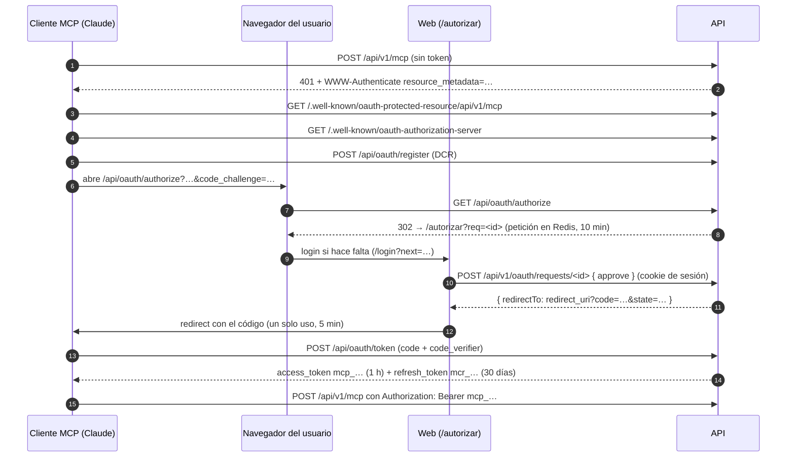

# Servidor MCP: la IA gestiona dispositivos y pantallas

La API trae un servidor [MCP](https://modelcontextprotocol.io) para que un asistente (Claude Code, claude.ai, Claude Desktop, ChatGPT, Cursor…) gestione en nombre de un usuario sus dispositivos y sus pantallas MetaDisplay: diseñar y guardar plantillas, subir imágenes, enviar datos y comandos y leer los toques y los botones.

El acceso se autoriza con **OAuth 2.1**. El usuario aprueba la conexión en la web con su sesión y la puede revocar cuando quiera.

| | |
|---|---|
| URL del MCP | `https://<tu-dominio>/api/v1/mcp` (prod: `https://atekos.toxolinko.site/api/v1/mcp`; dev: `http://localhost:8080/api/v1/mcp`) |
| Transporte | Streamable HTTP sin estado: un `POST` por mensaje JSON-RPC y respuesta en JSON. No hay stream `GET` ni sesiones. |
| Autorización | OAuth 2.1 con registro dinámico de clientes (DCR), PKCE S256 y refresh tokens con rotación. |
| Código | `apps/api/src/mcp/` (servidor y ruta) y `apps/api/src/modules/oauth/` (servidor de autorización). |

## Arquitectura

La API es a la vez **servidor de autorización** y **servidor de recursos**. El MCP no reenvía tokens ni llama a la REST: llama a los mismos casos de uso (`c.devices.*`, `c.displays.*`). Por eso los permisos, la validación, la caché de Redis, el log de eventos y el envío en vivo a las pantallas son idénticos a los de la web.



### Endpoints

| Ruta | Quién | Qué hace |
|---|---|---|
| `GET /.well-known/oauth-protected-resource/api/v1/mcp` | público | Metadatos del recurso (RFC 9728): `resource` y `authorization_servers`. |
| `GET /.well-known/oauth-authorization-server` | público | Metadatos del servidor de autorización (RFC 8414). |
| `POST /api/oauth/register` | público, 20/h por IP | Registro dinámico de clientes (RFC 7591). |
| `GET /api/oauth/authorize` | navegador, 100/15 min por IP | Valida cliente, `redirect_uri`, PKCE S256 y `resource`, y redirige a `/autorizar`. |
| `POST /api/oauth/token` | cliente, 50/15 min por IP | `authorization_code` y `refresh_token`. Va en `application/x-www-form-urlencoded`. |
| `POST /api/oauth/revoke` | cliente | Revoca el grant de un access o refresh (RFC 7009). |
| `GET` / `POST /api/v1/oauth/requests/:id` | sesión | La pantalla de consentimiento: ver la petición y aprobarla o denegarla. |
| `GET /api/v1/oauth/grants` · `DELETE /api/v1/oauth/grants/:id` | sesión | «Apps conectadas» en la página Tokens: listar y revocar. |
| `POST /api/v1/mcp` | Bearer OAuth, 300/min por app | Mensajes MCP, con cuerpos de hasta `DISPLAY_MAX_TEMPLATE_BYTES` (1 MB por defecto, como `/api/v1/displays`). `GET` y `DELETE` → 405. |

Las rutas de OAuth van bajo `/api/oauth/` y no en la raíz porque `/register` es una ruta de la web. Solo los dos `/.well-known/oauth-*` tienen que estar en la raíz del dominio: Caddy los envía a la API.

## Permisos

El consentimiento concede estos scopes. El cliente puede pedir menos; si no pide ninguno válido, se conceden los tres.

| Scope | Permite |
|---|---|
| `devices:read` | `list_devices`, `get_device`. |
| `devices:write` | `create_device`, `set_device_state`, `update_device_data`. |
| `displays:write` | Todas las de pantallas: `list_displays`, `get_display`, `get_display_template`, `create_display`, `set_display_template`, `update_display`, `delete_display_template`, `update_display_data`, `send_display_command`, `list_display_events` y `upload_display_image`. |
| cualquiera | `get_display_guide`, `get_display_contract` y sus recursos (son públicos). |

- El grant actúa como un **token sin ligar del usuario** (`kind: 'token'`, sin `deviceId` ni `displayId`). Las políticas de siempre (`canRead`, `canWrite`, `canAdminDisplay`) deciden con sus scopes.
- **Altas:** `canCreate` (`apps/api/src/modules/devices/domain/policy.ts`) deja crear a la sesión y a un token sin ligar con el scope de escritura. La REST no cambia: `POST /devices` y `POST /displays` siguen exigiendo sesión en la ruta. Solo el MCP llega al caso de uso con un token.
- **Qué puede borrar:** solo plantillas guardadas de una pantalla (`delete_display_template`, nunca la activa). **No se exponen** borrar dispositivos o pantallas, crear tokens, cambiar la visibilidad ni la telemetría.
- Los comandos a la pantalla se limitan a `display.refresh`, `display.brightness` y `display.info`, igual que la REST, y quedan auditados con el id del grant.

## Herramientas

Todas devuelven el JSON del caso de uso en `content[0].text`. Un error del dominio vuelve como **resultado con `isError: true`** y el cuerpo `{ error, message, issues }`, con los mismos códigos que la REST (`not_found`, `forbidden`, `conflict`, `invalid_template`…). Un argumento que no cumple el esquema vuelve como `isError` con el detalle de zod. En los dos casos la IA puede corregir y reintentar.

| Herramienta | Entrada | Devuelve |
|---|---|---|
| `list_devices` | — | `Device[]` |
| `get_device` | `{ id }` (uuid) | `Device` |
| `create_device` | `{ slug, name, type?, visibility?, description?, data? }` (`CreateDeviceInput`) | `Device` (409 `conflict` si el slug ya es tuyo) |
| `set_device_state` | `{ id, state }` | `Device` |
| `update_device_data` | `{ id, data }`, con merge superficial sobre `data` | `Device` |
| `list_displays` | — | `Display[]`, con `online` y `lastSeenAt` |
| `get_display` | `{ deviceId }` (`md-` + 12 hex) | `DisplayDetail`: plantilla activa (imágenes por referencia), plantillas guardadas, valores, `info` (ficha de la placa) y `lastSeenAt`. Añade `variables`: las que nombra la plantilla activa (`templateVariables`). |
| `get_display_template` | `{ deviceId, templateId? }` | La plantilla completa (la activa por defecto), con las imágenes por referencia. |
| `create_display` | `{ deviceId, name }` | `Display`, con la plantilla `inicio` |
| `set_display_template` | `{ deviceId, template, activate? = true }` | `DisplayDetail`. Con `activate: true` guarda y activa (como `PUT /template`); con `false` guarda sin activar (como `PUT /templates/{id}`), para las pantallas destino de `screen.<id>`. Acepta imágenes por referencia. |
| `update_display` | `{ deviceId, name?, activeTemplateId? }` (`PatchDisplayInput`) | `Display`. Renombra y/o activa una plantilla guardada (422 `template_not_found` si no existe). |
| `delete_display_template` | `{ deviceId, templateId }` | `{ ok: true }`. La activa → 409 `conflict`. Es la única herramienta destructiva (`destructiveHint`). |
| `update_display_data` | `{ deviceId, values, replace? = false }` (`DisplayValues`) | `{ values }`. Merge (como `PATCH /data`) por defecto; `replace: true` sustituye todos (como `PUT /data`), que es como se quitan variables. Es la única vía por la que les llegan valores a las variables de la plantilla. |
| `send_display_command` | `{ deviceId, command }` (`DisplayCommand`: `display.refresh`, `display.brightness { percent 0–50 }` o `display.info`) | `{ ok: true }`. Sin conexión → 409 `device_offline`. |
| `list_display_events` | `{ deviceId, limit? = 20 }` (1–200) | `DisplayEvent[]`: toques y botones, del más reciente al más antiguo. |
| `upload_display_image` | `{ deviceId, url? \| base64?, width, height, fit? = 'contain', background? = '#000000' }` | `{ ref, element, bytes }`. Ver «Imágenes por referencia». |
| `get_display_guide` | — | La guía para la IA, en Markdown (ver «Guía para la IA»). |
| `get_display_contract` | `{ part?: 'asyncapi' \| 'openapi' }` (por defecto `asyncapi`) | El contrato MetaDisplay vigente: `info.version` e `info["x-updated"]` dicen su versión y su última actualización ([`metadisplay/README.md`](metadisplay/README.md)). |

Los esquemas de entrada son los de `packages/shared`, así que la IA recibe el mismo JSON Schema que valida la REST. La excepción es la plantilla de `set_display_template`, que usa `DisplayTemplateShape`: los mismos campos y tipos sin las comprobaciones semánticas, porque una imagen puede llegar por referencia. Después de resolver las referencias se valida con `DisplayTemplate`, y un fallo devuelve `invalid_template` con `issues`, como la REST.

Recursos MCP, para los clientes que permiten adjuntarlos (por ejemplo, con `@` en Claude Code): `atekos://guide/pantallas.md` (la guía) y el contrato en `atekos://contract/asyncapi.json` y `atekos://contract/openapi.json`.

### Imágenes por referencia

Una plantilla con imágenes ocupa cientos de KB de base64. Una IA no puede copiarlos de una respuesta a otra sin gastar contexto, y es fácil que los corrompa. Por eso el MCP las mueve **por referencia**:

- Referencia = `ref:` + los 16 primeros hex del SHA-256 del `data`.
- **Salida:** en todo lo que devuelve el MCP (`get_display`, `get_display_template`, `set_display_template`), el `data` de cada elemento `image`, en `elements` y en `animation.frames[].elements`, va sustituido por su referencia.
- **Entrada:** en `set_display_template`, un `data` que empieza por `ref:` se busca, en este orden, en las subidas recientes de esa pantalla y en las imágenes de todas sus plantillas guardadas, y se sustituye por la imagen (con su `encoding`). Si no aparece → `unknown_image_ref` con la ruta del elemento en `issues`. Un `data` en base64 normal sigue valiendo.
- Así, leer una plantilla, cambiarla y guardarla con `version` + 1 conserva sus imágenes sin que la IA vea un solo byte.

**`upload_display_image`** convierte un PNG o JPEG en un elemento `image`:

- Exactamente uno de `url` o `base64` (el archivo en base64, con o sin prefijo `data:`). Con `base64`, el límite real es el cuerpo del MCP: unos 750 KB de archivo con el tope de 1 MB.
- Decodifica en el servidor con `pngjs` y `jpeg-js`, que son JS puro: la API sigue empaquetada en un solo `dist/main.js`. El origen puede ocupar hasta 8 MB y medir hasta 4096×4096 px; el tamaño de un PNG se comprueba en su cabecera antes de descomprimirlo.
- Redimensiona a `width`×`height` (lo que quepa en 172×320 o en 320×172) con promedio de área al reducir y bilineal al ampliar. Compone el alfa sobre `background` y respeta `fit`: `contain` (entera, con bandas), `cover` (llena y recorta el centro) o `fill` (estira).
- Codifica con `encodeImage` de shared (la más corta de `rgb565` y `rgb565-rle`) y guarda `{ encoding, data, w, h }` en Redis, en `dimg:{displayId}:{ref}`, durante 24 h. Las imágenes que ya están en una plantilla guardada no caducan, porque se resuelven desde la plantilla.
- Devuelve `{ ref, element: { type: 'image', x: 0, y: 0, w, h, encoding, data: ref }, bytes }`, y la IA lo coloca cambiando `x`/`y`.
- **`url`:**
  - Solo `https:`.
  - Se resuelve el DNS y se rechaza cualquier IP privada, de loopback, link-local (los metadatos de la nube incluidos), CGNAT, ULA, multicast o reservada, con `BlockList` de `node:net`. La comprobación va en el `lookup` de la propia conexión, así que un DNS que cambia entre medias no la esquiva; una IP literal se comprueba antes.
  - Como mucho 3 redirecciones, comprobando cada una; 10 s en total; `content-type` de imagen.
- Errores: `invalid_input`, `invalid_size`, `unsupported_image`, `image_too_large`, `fetch_failed` y `forbidden_url`.

Código: `apps/api/src/mcp/images.ts` y `fetch-image.ts`.

### Guía para la IA

Para que cualquier modelo (Claude, ChatGPT…) haga exactamente lo que pide el usuario, el servidor le da dos niveles de instrucciones:

1. **`instructions`** del servidor, que el cliente recibe al conectar:
   - el modelo mental: pantalla, plantillas guardadas y activa, y datos = variables = «parámetros»;
   - el flujo;
   - las reglas de oro: sube `version`, el lienzo según `rotation`, imágenes con `upload_display_image` y referencias, nunca inventar base64, textos en ASCII, cómo leer los errores;
   - que consulte la guía.
2. **`get_display_guide`** (y el recurso `atekos://guide/pantallas.md`): una guía Markdown exhaustiva escrita para una IA, en `apps/api/src/mcp/guide.ts`. Cubre:
   - los conceptos, el lienzo y la rotación con coordenadas;
   - cada elemento con todos sus campos, rangos y un ejemplo;
   - la capa dinámica: `bind`, `binds` (con la tabla de propiedades ligables), `format`, `when` y el orden de evaluación de `render.ts`;
   - la animación, las acciones y sus eventos (`screen.<id>`, `data.refresh`, `data.set`), los botones físicos y la ficha de la placa;
   - las imágenes, los comandos, los eventos y los límites;
   - cada error con cómo corregirlo;
   - recetas paso a paso con el JSON exacto y una checklist antes de guardar.

Las medidas y los topes de la guía salen de las constantes de shared y del `DISPLAY_MAX_TEMPLATE_BYTES` del despliegue. `apps/api/test/mcp-guide.test.ts` valida con los esquemas cada plantilla y cada elemento de ejemplo de la guía, para que no se quede atrás si cambian.

### Flujo típico de una pantalla

1. `create_display { "deviceId": "md-34B7DA01ABCD", "name": "Salón" }` (o `list_displays` si ya existe) y `get_display`.
2. Si hay imágenes: `upload_display_image { "deviceId": "md-34B7DA01ABCD", "url": "https://…/foto.jpg", "width": 172, "height": 320, "fit": "cover" }`.
3. `set_display_template` con una plantilla como [`status-template.json`](metadisplay/examples/status-template.json) o [`showcase-template.json`](metadisplay/examples/showcase-template.json), con las imágenes por su `ref:`.
   - El lienzo es de 172×320, o de 320×172 con `rotation` 90/270.
   - La plantilla no declara variables: los elementos las nombran con `bind`, `format`, `binds` o `when`, y sus valores llegan con `update_display_data`.
   - Para cambiar una plantilla que ya existe con el mismo `id`, sube `version`.
   - Las pantallas destino de `screen.<id>` se guardan antes con `activate: false`.
4. `update_display_data { "deviceId": "md-34B7DA01ABCD", "values": { "serverStatus": "OK", "daysText": "hace 2 min" } }`.
5. Comprobar con `get_display` (`online`, `values`, `variables`) y, si hay acciones, con `list_display_events`.
6. La pantalla física necesita su token `display:connect`, que el usuario crea en la web (Tokens). El MCP no crea tokens.

Formato completo de plantillas y valores: la guía de la IA, [`metadisplay/PLANTILLAS.md`](metadisplay/PLANTILLAS.md) (guía práctica), [`metadisplay/DISENO.md`](metadisplay/DISENO.md) y [`metadisplay/CONTRATO.md`](metadisplay/CONTRATO.md).

## Conectar un cliente

Todos descubren OAuth solos a partir de la URL: no hay que copiar tokens.

**Claude Code**

```bash
claude mcp add --transport http --scope user atekos https://atekos.toxolinko.site/api/v1/mcp
```

Después, dentro de Claude Code: `/mcp` → `atekos` → *Authenticate*. Se abre el navegador con la pantalla «Autorizar a Claude Code». En dev, la URL es `http://localhost:8080/api/v1/mcp`.

**claude.ai y Claude Desktop**

*Ajustes → Conectores → Añadir conector personalizado*, con la URL de producción. Conecta desde los servidores de Anthropic, así que necesita la URL pública (con localhost no funciona).

**ChatGPT**

ChatGPT admite servidores MCP remotos como conectores personalizados. Las opciones exactas cambian según el plan y la versión, así que la ruta es orientativa:

1. Activa el **modo desarrollador** en los ajustes de ChatGPT (en las opciones avanzadas de conectores o apps).
2. En **Conectores / Apps**, crea un conector nuevo con la URL `https://atekos.toxolinko.site/api/v1/mcp` y autenticación **OAuth**.
3. ChatGPT descubre el servidor de autorización y se registra solo (DCR). Se abre la pantalla «Autorizar» de la web, donde apruebas con tu sesión.
4. En una conversación, activa el conector. Para que haga bien las pantallas, pídele que lea antes la guía (`get_display_guide`); las `instructions` del servidor ya se lo indican.

Como claude.ai, conecta desde los servidores de OpenAI: necesita la URL pública.

**Cursor** (`~/.cursor/mcp.json`)

```json
{ "mcpServers": { "atekos": { "url": "https://atekos.toxolinko.site/api/v1/mcp" } } }
```

Para **desconectar**, entra en la web → Tokens → «Apps conectadas (IA)» → *Revocar*. El efecto es inmediato: el siguiente mensaje del cliente recibe un 401.

## Configuración y despliegue

- **`PUBLIC_URL`** (env de la API): la URL pública sin barra final. Es el issuer de OAuth y la base de todas las URLs anunciadas. **Si falta, la API arranca sin OAuth ni MCP** y lo avisa en el log (así un despliegue sin la variable no tumba nada).
  - Dev: `compose.dev.yml` ya pone `http://localhost:8080`.
  - Prod con compose: `compose.prod.yml` pone `https://${DOMAIN}`.
  - **Coolify (imagen única):** añade `PUBLIC_URL=https://atekos.toxolinko.site` en las variables de entorno de la aplicación y vuelve a desplegar.
  - Solo se acepta `http` en `localhost` o `127.0.0.1`; en cualquier otro host tiene que ser `https`.
- **Caddy** (`infra/proxy/Caddyfile`, `Caddyfile.dev` e `infra/single/Caddyfile`):
  - Envía `/.well-known/oauth-*` a la API; `/api/*` ya iba.
  - Pone `X-Frame-Options: DENY` y `frame-ancestors 'none'` a la web para que nadie enmarque la pantalla de consentimiento.
  - En Coolify, el HTTPS lo sigue poniendo su proxy delante del `:8080`.
- **Base de datos:** la migración `0002` crea `oauth_clients` y `oauth_grants`; se aplica sola al arrancar. Las peticiones pendientes y los códigos viven en Redis (`oauth:req:*` y `oauth:code:*`) con TTL.

## Seguridad

- **PKCE S256 obligatorio.** El código es de un solo uso (GETDEL), dura 5 minutos y está ligado al cliente y al `redirect_uri`.
- **Tokens opacos:** `mcp_` es el access (1 h) y `mcr_` el refresh (30 días, se renueva en cada uso). En la BD solo se guarda su HMAC con `TOKEN_PEPPER`, como los tokens de API.
- **Rotación:** cada refresco emite un par nuevo e invalida el anterior en un solo `UPDATE`. Reusar un refresh ya rotado da `invalid_grant`.
  - Límite conocido: el reuso no revoca el grant entero (está marcado con `shortcut:` en `provider.ts`).
- **Audiencia:** si el cliente envía `resource` (RFC 8707) en `authorize`, `token` o `refresh`, tiene que ser la URL del MCP; si no, `invalid_target`. Los tokens OAuth **solo valen en `/api/v1/mcp`**: la REST los rechaza con 401. Al revés tampoco funciona: un `dmt_` no vale en el MCP.
- **Consentimiento:**
  - Pide la sesión web. La pantalla enseña el nombre del cliente, el host al que se volverá y los permisos.
  - La petición se consume al decidir.
  - `?next=` del login solo acepta rutas de la propia web (no `//host`), para que no haya open redirect.
  - El POST de la decisión pasa por el filtro CSRF de la API (solo JSON) y por la cookie `SameSite=Lax`.
- **Revocación inmediata:** cada mensaje MCP verifica el access contra PG por índice único, sin caché.
- **Límites:**
  - DCR, `authorize` y `token` tienen el rate limit por IP del SDK. La IP real llega por `X-Forwarded-For` desde Caddy (`trust proxy` = 1).
  - El MCP permite 300 mensajes por minuto por app conectada.
  - El cuerpo admite hasta `DISPLAY_MAX_TEMPLATE_BYTES` (1 MB por defecto), como `/api/v1/displays`; el resto de la API sigue en 32 KB.
- **`upload_display_image` con `url`:** guardia SSRF (solo https, IPs públicas comprobadas en la propia conexión, 3 redirecciones, 10 s, 8 MB). Las subidas viven 24 h en Redis, por pantalla.
- El `client_secret` de los clientes confidenciales se guarda en claro en `oauth_clients.info`, porque el SDK lo compara así. Por sí solo no da tokens: hace falta un código aprobado por el usuario y su verificador PKCE.

Fuera de alcance por ahora:
- Client ID Metadata Documents: DCR basta para Claude y Cursor.
- CORS en `/api/v1/mcp` para clientes que corren en el navegador.
- Limpiar los clientes DCR que nadie usa.

## Probar a mano

```bash
B=http://localhost:8080
curl -s $B/.well-known/oauth-authorization-server | jq
curl -si -X POST $B/api/v1/mcp -H 'content-type: application/json' -d '{}' | grep -i www-authenticate
curl -s -X POST $B/api/oauth/register -H 'content-type: application/json' \
  -d '{"client_name":"curl","redirect_uris":["http://localhost:9999/cb"],"token_endpoint_auth_method":"none"}' | jq
```

Con un token ya emitido (por ejemplo, el de Claude Code):

```bash
curl -s -X POST $B/api/v1/mcp -H "authorization: Bearer $TOKEN" \
  -H 'content-type: application/json' -H 'accept: application/json, text/event-stream' \
  -d '{"jsonrpc":"2.0","id":1,"method":"tools/call","params":{"name":"list_devices","arguments":{}}}' | jq
```

El [MCP Inspector](https://github.com/modelcontextprotocol/inspector) (`npx @modelcontextprotocol/inspector`) también sirve. Se elige el transporte *Streamable HTTP* con la URL del MCP y hace el flujo OAuth completo.

Tests: `apps/api/test/oauth.test.ts` (servidor de autorización), `apps/api/test/mcp.test.ts` (herramientas y recursos con el cliente del SDK), `apps/api/test/mcp-images.test.ts` (redimensionado, referencias y guardia SSRF) y `apps/api/test/mcp-guide.test.ts` (los ejemplos de la guía).
